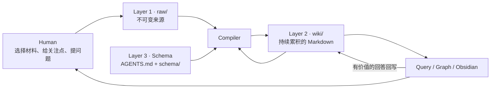
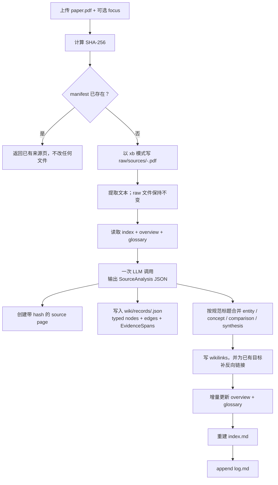
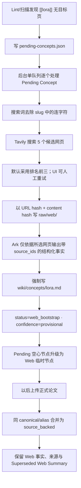

# LLM Wiki MVP：结构、目录与文件职责

本文档是本项目的实现说明书。它记录 Karpathy 原始想法与本 MVP 的一一对应关系、
所有目录和文件的职责、数据流、页面契约、Graph 的形成方式，以及后续进行检索
算法创新时应替换的边界。

## 1. “完全一致”具体指什么

Karpathy 的原文是一种 pattern，不是一份固定的软件规范；原文最后明确指出，
“exact directory structure、schema conventions、page formats、tooling”需要由使用者
和 LLM 针对领域共同确定。因此不存在一棵可逐字复制的官方目录树。

本项目完整实现原文中不可缺少的结构语义：

| Karpathy pattern | 本项目实现 |
|---|---|
| Raw sources：不可变的事实来源 | `raw/`，哈希命名、只新增、不覆盖 |
| Wiki：LLM 持续维护的 Markdown 知识层 | `wiki/` 下的来源、实体、概念、比较、综合页面 |
| Schema：约束 LLM 的结构和工作流 | `AGENTS.md`、`CLAUDE.md`、`schema/` |
| Ingest | 上传/CLI → 提取 → 一次 LLM 编译 → 确定性合并 |
| Query | 先读 index，再从 Wiki 选页、综合，可回写 synthesis |
| Lint | 检查矛盾、断链、孤儿、重复标题、缺失来源 |
| Content-oriented index | `wiki/index.md` |
| Chronological append-only log | `wiki/log.md` |
| Obsidian 作为 Wiki IDE / Graph View | 标准 Markdown + `[[wikilink]]` + `.obsidian/` |

页面子目录不是对原文的偏离，而是 schema 层对“summaries, entity pages, concept
pages, comparisons, overview, synthesis”的具体实例化。

## 2. 三层架构



关键区别在于：Query 的主要上下文是 `wiki/`，不是每次重新检索和拼装 raw
chunks。原始材料只在 Ingest 时被“编译”；知识页会随着新材料增量更新。

## 3. 完整目录树

```text
EssayPod/llm_wiki/
├── AGENTS.md                   # Codex/通用 Agent 的 schema 与硬约束
├── CLAUDE.md                   # Claude Code 入口，指向同一 schema
├── ARCHITECTURE.md             # 本文件：结构与职责的完整记录
├── README.md                   # 安装、运行、使用和 MVP 边界
├── .env.example                # LLM provider 与服务参数模板
├── .gitignore                  # 排除密钥、虚拟环境、缓存和 runtime
├── pyproject.toml              # Python 包、依赖和 llm-wiki CLI 入口
├── setup.sh                    # 创建 .venv 并安装项目
├── run.sh                      # 启动本地 Web 服务
├── .obsidian/
│   ├── app.json                # Obsidian vault 基础设置
│   └── graph.json              # Graph View 的显示设置
├── raw/                        # Layer 1：不可变源数据
│   ├── manifest.jsonl          # append-only 摄取清单、SHA-256 与原文件名
│   ├── sources/                # PDF/MD/TXT 等原始材料，只新增
│   ├── web/                    # Tavily 发现并由用户选择的不可变网页快照
│   └── assets/                 # 来源引用的本地图片等附件
├── wiki/                       # Layer 2：LLM 拥有的持久知识
│   ├── index.md                # 按类别列页面与一句话摘要；每次变更后重建
│   ├── log.md                  # ingest/query/lint 的 append-only 时间线
│   ├── overview.md             # 全库不断演化的高层综合、主题和开放问题
│   ├── glossary.md             # 规范术语，减少同义重复页面
│   ├── lint-report.md          # lint 后生成的最新健康报告
│   ├── pending-concepts.json   # 悬空 wikilink 聚合出的待补概念
│   ├── sources/                # 每份 raw source 对应一个证据摘要页
│   ├── entities/               # 人、机构、系统、数据集等实体
│   ├── concepts/               # 方法、理论、机制与术语
│   ├── comparisons/            # 跨来源/跨方法的显式比较
│   ├── syntheses/              # 多页综合与被用户选择回写的查询答案
│   └── records/                # 每篇来源的原子知识 JSON（typed graph + evidence）
├── schema/                     # Layer 3：机器可读/人可读契约
│   ├── README.md               # JSON 输出契约说明
│   ├── ingest-output.schema.json
│   ├── paper-knowledge.schema.json
│   └── web-concept-output.schema.json
├── llm_wiki/                   # 运行时实现
│   ├── __init__.py             # 包版本
│   ├── __main__.py             # `python -m llm_wiki`
│   ├── cli.py                  # serve/ingest/query/lint/status 命令
│   ├── config.py               # .env 读取和配置对象
│   ├── models.py               # Ingest 与 Web Concept 的结构化数据模型
│   ├── knowledge.py            # 原子节点/关系归一化、校验、持久化与聚合
│   ├── extractors.py           # PDF 与文本类材料的纯文本提取
│   ├── llm.py                  # Prompt、JSON 校验、Mock/Ollama/API 后端
│   ├── store.py                # immutable raw、frontmatter、原子写、index
│   ├── compiler.py             # 核心 ingest 编译器与增量页面合并
│   ├── query.py                # Wiki-only 候选检索、回答与 synthesis 回写
│   ├── lint.py                 # Wiki 结构健康检查
│   ├── web_research.py         # Tavily、候选会话、网页快照与临时 Concept
│   ├── server.py               # 零框架本地 JSON API/静态文件服务器
│   └── web/
│       ├── index.html          # 单页 Web UI 结构
│       ├── style.css           # UI 与响应式布局
│       ├── app.js              # 上传、查询、页面浏览、lint 的客户端逻辑
│       ├── graph.html          # Pixi Graph View 独立预览页
│       ├── graph.css           # Graph 画布、控制面板和响应式布局
│       ├── graph-src.js        # PixiJS + d3-force 的可维护源代码
│       └── graph.js            # esbuild 生成的浏览器 bundle
├── tools/
│   └── graph-preview/
│       ├── package.json        # 固定 PixiJS、d3-force、esbuild 版本
│       ├── build.mjs           # 从 web 源文件解析依赖并生成 bundle
│       └── pnpm-lock.yaml      # 前端依赖锁文件
├── tests/
│   └── test_mvp.py             # 不调用外部模型的端到端单元测试
└── runtime/                    # 可丢弃运行状态；不属于知识库
```

空目录中的 `.gitkeep` 只用于让 Git 保留目录，不承担运行逻辑。

## 4. Ingest：论文如何变成 Wiki 与 Graph



单次 LLM 输出的 `SourceAnalysis` 包括：

- 来源标题、摘要、关键论点、短引用和标签；
- 任意数量的 `entity | concept | comparison | synthesis` 页面 proposal；
- 每个 proposal 的摘要、事实、连接和矛盾；
- 全库 overview 的新综合、主题和开放问题；
- glossary 新术语。
- Concept、Claim、Method、Dataset、Experiment、Metric、Result、Limitation、
  Hypothesis、Definition、ResearchQuestion 原子节点；
- 带类型、限定条件、置信度和证据引用的关系；
- 带原文短引、页码、章节和来源路径的 EvidenceSpan。

程序而不是模型负责落盘规则：去重、原子写入、旧事实保留、contradiction 合并、
来源 provenance、双向链接、index 重建和 log 追加。这样可让不同模型输出落到同一个
稳定结构。

### 页面身份与合并

- raw 文件：`原名slug-SHA256前10位.扩展名`。
- source page：`论文标题slug-SHA256前10位.md`；同名论文不会覆盖。
- 知识页：`规范标题slug.md`；同一概念再次出现时更新原页面，形成跨来源累积。
- glossary 是命名规范的上下文，模型应优先沿用已有名称，避免同义分裂。

### Graph 如何产生

Graph 不单独保存在专有数据库中。节点是 Wiki Markdown 页面；边是正文中的
`[[filename-slug]]`。Obsidian 会直接把这些链接渲染为图。

来源页连接到它触及的知识页；知识页连接回来源页和相关知识页；当 proposal 指向
已存在页面时，编译器会补反向链接。由于 Graph 是普通文件的派生视图，后续可以
无锁地增加 PageRank、社区发现、路径检索或图神经网络实验。

细粒度研究知识由 `wiki/records/*.json` 聚合，通过
`/api/knowledge/graph` 提供。当前 `/api/graph` 继续作为简洁的人类 Wiki 页面图；
两者刻意分离，避免将每条 Claim、Result 和 Evidence 默认铺满 UI。原子图中的
全局对象是 Concept、Method、Dataset、Metric，其他节点保留论文作用域。SQLite
后续只作为可重建索引，不作为知识的唯一来源。

## 5. 页面契约

每个生成页使用统一 frontmatter：

```yaml
---
title: "Retrieval-Augmented Generation"
type: "concept"
created: "2026-07-30"
updated: "2026-07-30"
sources: ["raw/sources/paper-a1b2c3d4e5.pdf"]
tags: ["concept"]
---
```

知识页正文固定包含：

```markdown
# Page title

一句话摘要。

## Key Facts

- 来自材料的事实……

## Contradictions

- 与已有结论的冲突；没有时保留显式占位。

## Related Pages

- [[another-page]]
- [[source-page-hash]]

## Sources

- `raw/sources/source-file-hash.pdf`
```

固定标题让增量合并不依赖脆弱的自由文本定位，也方便未来建立结构化索引。

## 6. Query：检索边界

1. 必须先读 `wiki/index.md`。
2. 当前 MVP 对问题与 Wiki 页面做词项交集评分，取前 8 页。
3. 只把 index 与选中的编译页面交给 LLM，不重新读取 raw。
4. 回答要求使用 `[[page-slug]]` 引用，并显式报告不确定性/矛盾。
5. 用户选择“保存”时写入 `wiki/syntheses/`，重建 index 并记录 log。

`llm_wiki/query.py` 是检索创新的主要替换点。可以保持输入输出契约不变，仅替换
候选生成和排序：

```text
question
  → candidate retrieval (lexical / BM25 / vector / graph)
  → top-k wiki pages
  → LLM synthesis
  → optional synthesis page
```

适合后续研究的方向包括：

- BM25 与 embedding 的 hybrid retrieval；
- wikilink 邻域扩展、Personalized PageRank 和多跳路径检索；
- source page、concept page、synthesis page 的类型感知排序；
- 矛盾密度、来源数、更新时间和中心性作为 reranking feature；
- 查询后将有效新连接回写 Graph，再用于下一次检索。

## 7. Lint：结构健康检查

当前检查：

- frontmatter 必需字段；
- 相同标题是否落在多个页面；
- `[[wikilink]]` 是否指向尚未建立的 Pending Concept；
- 非来源页是否缺 `Related Pages` 或来源；
- 已记录的矛盾；
- 没有入边的知识孤儿页。

结果覆盖写入 `wiki/lint-report.md`（它是“最新报告”而不是历史），每次执行同时
append `wiki/log.md`。未来可增加 stale claim、missing reciprocal link、source
coverage、同义实体合并建议和待补材料建议。

## 8. Web Research：Pending Concept 如何补全



搜索结果本身不是知识来源。实际入库的是后台默认选择的前三个网页正文、URL、访问
时间和内容哈希；UI 保留人工检查与手动重试。网页正文进入 LLM prompt 时被明确
包裹为不可信证据，模型不得执行其中的指令，且每条生成事实必须引用有效的 `S1`、
`S2` 等来源 ID。

为了避免递归搜索爆炸，单次只允许选择最多 3 个来源；Web 页中尚不存在的相关
概念保留为普通文本，不继续自动产生 wikilink。页面文件名始终使用用户请求的
Pending ID，例如搜索 “LoRA” 必须补成 `lora.md`，从而立即修复旧链接。

## 9. API 契约

| Method | Path | 作用 |
|---|---|---|
| GET | `/api/status` | provider、source/page 数量 |
| GET | `/api/pages` | 页面列表与摘要 |
| GET | `/api/graph` | 从 Wiki 页面与 wikilink 派生节点和边 |
| GET | `/api/pending` | 当前 Pending Concept、引用次数与来源页面 |
| GET | `/api/page?path=wiki/...` | 读取单个 Wiki 页面 |
| GET | `/graph` | PixiJS + d3-force 的交互式 Graph View |
| GET | `/page?path=wiki/...` | 渲染后的 Markdown 详情页 |
| POST | `/api/ingest` | multipart 的 `file` 与可选 `focus` |
| POST | `/api/query` | JSON：`question`、`save` |
| POST | `/api/lint` | 执行健康检查 |
| POST | `/api/research/search` | Tavily 搜索并建立短期候选会话 |
| POST | `/api/research/compile` | 选择候选索引并创建 Web 临时 Concept |

服务只监听 `127.0.0.1`（除非显式修改配置），页面读取端点限制在 `wiki/*.md`，
上传大小和提取文本长度均有配置上限。

`/graph` 打开即调用 `/api/graph` 显示当前 Wiki，不再携带示例数据。每个持久
Markdown 页面映射为节点，正文中的 `[[wikilink]]` 映射为有向边。节点摘要在
Inspector 中限长显示，`show the details` 进入 `/page` 渲染页面；页面中的
wikilink 会通过文件名、canonical ID、标题和 aliases 解析到真实详情页。渲染层
使用与 Logseq 当前 Graph View 相同的大类技术栈（PixiJS 8 + d3-force），实现
缩放、平移、拖拽、悬停、选择邻域、深度和连线距离控制。它用于隔离研究渲染与图
检索，不包含 Logseq 的 Datascript、编辑器、插件系统和完整应用状态，因此不能
称为完整 Logseq Graph View。

布局采用自适应力模型：`forceLink` 把引用关系视为弹簧，`forceManyBody` 让节点
相互排斥，`forceCollide` 避免节点和标签过度重叠，`forceCenter` 保持整体居中。
节点达到 24 个后额外启用弱 `forceRadial`：高连接度 Hub 的目标半径更小，低度
节点目标半径更大，因此大量叶子节点会近似环绕核心分布，而不是被硬编码到一个
固定圆周上。模拟稳定后根据节点边界自动缩放，使整个 Graph 适应当前画布。

## 10. LLM 后端与可复现性

- `mock`：确定性、无网络，用来证明整个软件管线和测试；不是语义模型。
- `ollama`：调用本地 `/api/chat`，要求 JSON mode。
- `ark`：调用火山方舟在线推理 `/api/v3/chat/completions`。存在
  `ARK_API_KEY` 且未显式选择其他 provider 时自动启用，默认使用
  `doubao-seed-2-0-pro-260215`。每次操作默认最多尝试两次；如果两次均失败且
  配置了 `DEEPSEEK_API_KEY`，自动把同一操作交给 DeepSeek。
- `deepseek`：调用 DeepSeek OpenAI-compatible `/chat/completions`，默认使用
  `deepseek-v4-pro`。可显式设为主 provider，也可作为 Ark 的自动回退。
- `openai-compatible`：调用 `/v1/chat/completions`，要求 JSON object response。

Ingest 将结构化编译压缩为一次模型调用。现有 Wiki 的 `index/overview/glossary`
会放入 prompt，模型因此能在已有知识和命名规范上整合新材料。机器可读 JSON
契约在 `schema/ingest-output.schema.json`。

原始材料会在模型调用前以内容哈希保存。若模型调用中断，后续重试检测到“原始
材料存在但对应 Source 页面不存在”时会从该 raw 文件断点续编；只有 raw 和
Source 页面都存在时才视为已经完整摄取。

## 11. 不变量与扩展原则

任何后续改造都应继续满足：

1. raw 只新增，永不覆盖。
2. Wiki 是查询的主要语义层，而非临时缓存。
3. 旧事实和冲突有可追溯来源；不能静默丢失。
4. 页面是持久 Markdown，Graph 能由 wikilinks 重建。
5. index 面向内容，log 面向时间且只追加。
6. 搜索引擎、向量库和图数据库属于 Wiki 的派生索引，不替代 Wiki 本体。
7. 高价值 query output 可以回写，知识通过摄取和探索两条路径共同复利。
